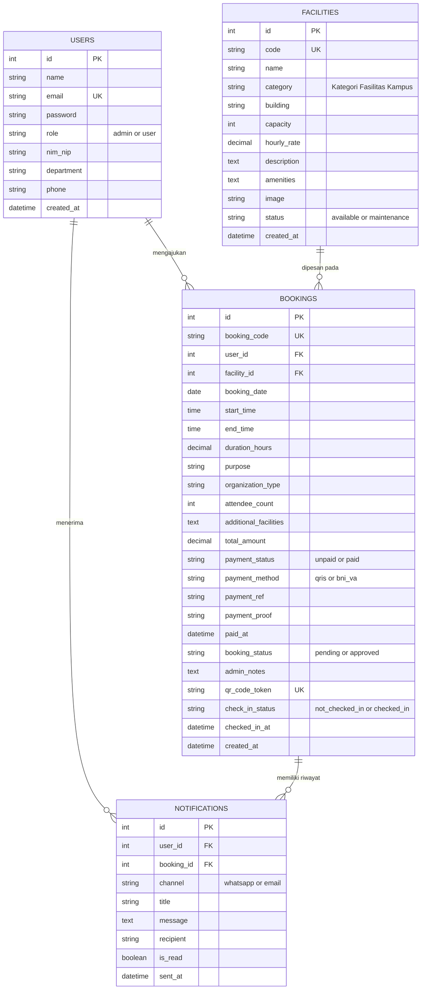

# LAPORAN PROJECT UTS - E-APPLICATION
### Program Studi D3 Teknik Informatika - Fakultas Vokasi Universitas Sumatera Utara

---

| Identitas Laporan | Keterangan |
|:---|:---|
| **Judul Project** | **E-Booking & E-Payment Fasilitas Kampus (USU SmartFacility)** |
| **Kelompok / Kelas** | Kelompok Mandiri / Kelas D3 TI-A (Semester Ganjil 2025/2026) |
| **Nama & NIM Anggota** | 1. **WillyChen234 / William Tanwijaya** (NIM: `[Isi NIM Anda]`) 2. *(Anggota 2 jika ada)* 3. *(Anggota 3 jika ada)* |
| **Link Demo / Github / Video** | - **GitHub Repository**: [https://github.com/WillyChen234/UTS_Eapp](https://github.com/WillyChen234/UTS_Eapp) - **Aplikasi Lokal**: `http://127.0.0.1:8000` - **Link Video Demo**: `[Tautan YouTube / Google Drive Video Demo Durasi 5-10 Menit]` |

---

## BAB I - PENDAHULUAN

### 1.1 Latar Belakang
Pengelolaan sarana dan prasarana (sarpras) di lingkungan perguruan tinggi, khususnya Fakultas Vokasi Universitas Sumatera Utara (USU), memegang peranan krusial dalam mendukung kelancaran kegiatan belajar mengajar, praktikum laboratorium, ujian kompetensi, serta berbagai kegiatan kemahasiswaan. Fasilitas seperti Laboratorium Komputer Multimedia & Jaringan, Aula Serbaguna Gedung Vokasi, Lapangan Olahraga, dan Ruang Seminar memiliki tingkat utilisasi yang sangat tinggi dan sering diperebutkan oleh berbagai pihak dalam waktu yang bersamaan.

Namun, sistem peminjaman yang selama ini berjalan masih konvensional, di mana pencatatan jadwal dilakukan secara terpisah di buku agenda fisik atau formulir lembaran kertas. Mekanisme manual ini kerap memicu permasalahan bentrok jadwal (*double-booking*), kesulitan bagi mahasiswa dalam mengecek ketersediaan ruangan secara cepat, serta birokrasi perizinan yang memakan waktu lama. Selain itu, transaksi peminjaman berbayar (retribusi pemeliharaan sarpras) belum memiliki rekonsiliasi pembayaran digital yang transparan dan akuntabel. Oleh karena itu, diperlukan suatu aplikasi berbasis web (*E-Application*) terpadu bernama **USU SmartFacility** yang memadukan reservasi online, validasi anti-bentrok jadwal otomatis, pembayaran elektronik multi-channel, dan penerbitan tiket elektronik ber-QR Code resmi.

### 1.2 Rumusan Masalah
Berdasarkan latar belakang di atas, rumusan masalah dalam perancangan aplikasi ini adalah:
1. Bagaimana merancang dan membangun sistem informasi peminjaman fasilitas kampus yang dapat mencegah terjadinya bentrok jadwal secara otomatis?
2. Bagaimana mengimplementasikan fitur transaksi elektronik (*E-Payment*) multi-channel (QRIS Standar Nasional dan Virtual Account Bank BNI) untuk kemudahan pembayaran retribusi pemakaian fasilitas?
3. Bagaimana mengintegrasikan sistem tiket digital ber-QR Code (*E-Ticket*) yang dapat diverifikasi dan divalidasi langsung di lokasi oleh petugas sarpras melalui pemindai (*scanner*)?

### 1.3 Tujuan
Tujuan yang ingin dicapai dari pembangunan proyek ini adalah:
1. Membuat aplikasi *E-Application* berbasis web yang mampu melayani pemesanan fasilitas kampus secara online, cepat, dan efisien selama 24 jam sehari.
2. Mengotomatisasi validasi ketersediaan waktu peminjaman dengan algoritma deteksi irisan waktu sehingga terhindar dari konflik reservasi.
3. Mengimplementasikan simulasi transaksi elektronik yang aman dan realistis dengan konfirmasi pembayaran otomatis.
4. Menyediakan modul pelaporan eksekutif yang merekapitulasi jam pemakaian fasilitas dan penerimaan kas retribusi sarpras dalam format Excel (CSV) dan PDF siap cetak.

### 1.4 Manfaat
1. **Bagi Pengguna (Mahasiswa, Dosen, dan Ormawa):** Memperoleh kepastian jadwal ruangan tanpa perlu datang fisik ke kantor sarpras, proses permohonan transparan, dan tiket pemakaian dapat disimpan langsung di smartphone.
2. **Bagi Kampus (Fakultas Vokasi USU):** Meningkatkan efisiensi kerja staf birokrasi, mengoptimalkan tata kelola aset BMN (*Barang Milik Negara*), serta menjamin akuntabilitas penerimaan dana pemeliharaan sarana prasarana.
3. **Bagi Mahasiswa Pengembang:** Sebagai media pembelajaran terapan untuk menguasai konsep *E-Application* secara menyeluruh, mulai dari perancangan arsitektur, manajemen database relasional, keamanan sesi, hingga integrasi pembayaran digital.

---

## BAB II - TINJAUAN PUSTAKA & PERANCANGAN

### 2.1 Konsep E-Application
*E-Application* (Aplikasi Elektronik) merupakan pemanfaatan teknologi informasi berbasis jaringan (khususnya web dan mobile) untuk mengotomatisasi proses bisnis dan interaksi transaksi antara institusi dengan pengguna. Dalam konteks sistem ini:
- **E-Booking:** Layanan reservasi sarana secara daring yang mengelola katalog ruangan, kalender ketersediaan dinamis, dan verifikasi alokasi waktu.
- **E-Payment:** Mekanisme pembayaran non-tunai melalui media elektronik. Sistem ini mengadopsi standar QRIS (*Quick Response Code Indonesian Standard*) dan Virtual Account (BNI) yang merupakan perbankan mitra resmi Universitas Sumatera Utara.
- **E-Ticketing & QR Verification:** Penerbitan bukti hak akses digital berbentuk QR Code unik terenkripsi token yang dapat dibaca oleh kamera perangkat untuk pencatatan kehadiran (*check-in presensi*).

---

### 2.2 Use Case Diagram
Sistem memiliki 2 (dua) aktor utama, yaitu **Mahasiswa / Ormawa** dan **Admin Sarpras USU**. Berikut diagram interaksi sistem:

```mermaid
flowchart LR
    subgraph Aktor ["Aktor Pengguna"]
        User["Mahasiswa / Ormawa"]
        Admin["Admin Sarpras USU"]
    end

    subgraph System ["Sistem E-Booking & E-Payment (USU SmartFacility)"]
        UC1(["Registrasi & Login Akun"])
        UC2(["Jelajahi Fasilitas & Detail Spesifikasi"])
        UC3(["Pantau Kalender Ketersediaan Real-Time"])
        UC4(["Pengajuan E-Booking Fasilitas"])
        UC5(["Validasi Otomatis Anti-Bentrok Jadwal"])
        UC6(["Transaksi E-Payment: QRIS / BNI VA"])
        UC7(["Akses E-Ticket & Unduh QR Code"])
        UC8(["Verifikasi Tiket & Check-in Mandiri"])
        UC9(["Approval / Penolakan Reservasi"])
        UC10(["Kelola Data Fasilitas CRUD"])
        UC11(["Dashboard KPI & Grafik Analitik"])
        UC12(["Rekapitulasi Laporan PDF & Excel"])
    end

    User --> UC1
    User --> UC2
    User --> UC3
    User --> UC4
    User --> UC6
    User --> UC7

    Admin --> UC1
    Admin --> UC8
    Admin --> UC9
    Admin --> UC10
    Admin --> UC11
    Admin --> UC12

    UC4 -.->|include| UC5
    UC4 -.->|include| UC6
    UC9 -.->|triggers| UC7
```

---

### 2.3 Entity Relationship Diagram (ERD)
Hubungan antar-entitas dalam basis data dirancang secara terstandarisasi untuk menjaga konsistensi data transaksi:

---

### 2.4 Desain Database (Struktur Tabel)

#### 1. Tabel `users` (Menyimpan Akun Multi-Role)
| Field | Tipe Data | Kunci | Keterangan |
|:---|:---|:---:|:---|
| `id` | INTEGER / INT | PK | ID unik pengguna (Auto Increment) |
| `name` | VARCHAR(100) | - | Nama lengkap mahasiswa / staf |
| `email` | VARCHAR(100) | UK | Alamat email civitas akademika USU |
| `password` | VARCHAR(255) | - | Hash sandi keamanan bcrypt |
| `role` | VARCHAR(20) | - | Peran hak akses: `admin` atau `user` |
| `nim_nip` | VARCHAR(30) | - | Nomor Induk Mahasiswa / NIP Dosen |
| `department`| VARCHAR(100) | - | Program studi atau unit kerja |
| `phone` | VARCHAR(20) | - | Nomor WhatsApp penerima notifikasi |
| `created_at`| DATETIME | - | Waktu pendaftaran akun |

#### 2. Tabel `facilities` (Katalog Sarana Prasarana Kampus)
| Field | Tipe Data | Kunci | Keterangan |
|:---|:---|:---:|:---|
| `id` | INTEGER / INT | PK | ID unik fasilitas |
| `code` | VARCHAR(20) | UK | Kode inventaris BMN (contoh: LAB-KOM-01) |
| `name` | VARCHAR(150) | - | Nama fasilitas / ruangan |
| `category` | VARCHAR(50) | - | Laboratorium, Aula, Lapangan, Ruang Seminar |
| `building` | VARCHAR(100) | - | Lokasi gedung di lingkungan Vokasi USU |
| `capacity` | INT | - | Kapasitas daya tampung maksimum orang |
| `hourly_rate`| DECIMAL(12,2)| - | Biaya retribusi per jam sewa (Rp) |
| `description`| TEXT | - | Spesifikasi teknis fasilitas |
| `amenities` | TEXT | - | Sarana penunjang (AC, Proyektor, Sound System) |
| `image` | VARCHAR(255) | - | Path file foto fasilitas |
| `status` | VARCHAR(20) | - | Status kesiapan: `available` / `maintenance` |

#### 3. Tabel `bookings` (Transaksi Reservasi & Pembayaran Elektronik)
| Field | Tipe Data | Kunci | Keterangan |
|:---|:---|:---:|:---|
| `id` | INTEGER / INT | PK | ID unik transaksi peminjaman |
| `booking_code`| VARCHAR(30)| UK | Nomor kode booking resmi (contoh: USU-202610-001) |
| `user_id` | INT | FK | ID pemohon (relasi ke tabel `users`) |
| `facility_id`| INT | FK | ID fasilitas (relasi ke tabel `facilities`) |
| `booking_date`| DATE | - | Tanggal pemakaian fasilitas |
| `start_time` | TIME | - | Jam mulai reservasi |
| `end_time` | TIME | - | Jam selesai reservasi |
| `duration_hours`| DECIMAL(4,1)| - | Total durasi pemakaian dalam jam |
| `purpose` | VARCHAR(255) | - | Nama acara / peruntukan kegiatan |
| `organization_type`| VARCHAR(50)| - | Ormawa, Kelas Kuliah, Umum |
| `attendee_count`| INT | - | Estimasi jumlah peserta hadir |
| `total_amount`| DECIMAL(12,2)| - | Total biaya transaksi (Rp) |
| `payment_status`| VARCHAR(30) | - | `unpaid`, `pending_verification`, `paid`, `free_academic` |
| `payment_method`| VARCHAR(30) | - | `qris`, `bni_va`, `gopay`, `transfer_manual` |
| `payment_ref` | VARCHAR(100) | - | Nomor referensi transaksi bank / e-wallet |
| `booking_status`| VARCHAR(30) | - | `pending`, `approved`, `rejected`, `completed`, `cancelled`|
| `admin_notes` | TEXT | - | Catatan persetujuan / alasan penolakan admin |
| `qr_code_token`| VARCHAR(64) | UK | Token acak unik untuk verifikasi E-Ticket QR |
| `check_in_status`| VARCHAR(20) | - | `not_checked_in` atau `checked_in` |
| `checked_in_at`| DATETIME | - | Timestamp kedatangan saat scan di pintu lab/aula |

#### 4. Tabel `notifications` (Log Pengiriman Notifikasi WhatsApp & Email)
| Field | Tipe Data | Kunci | Keterangan |
|:---|:---|:---:|:---|
| `id` | INTEGER / INT | PK | ID riwayat pesan |
| `user_id` | INT | FK | ID penerima pesan |
| `booking_id` | INT | FK | ID pemesanan terkait |
| `channel` | VARCHAR(20) | - | Media: `whatsapp` atau `email` |
| `title` | VARCHAR(150) | - | Judul notifikasi |
| `message` | TEXT | - | Isi lengkap pesan konfirmasi |
| `sent_at` | DATETIME | - | Waktu notifikasi terkirim |

---

### 2.5 Desain Interface (Mockup & Visual Layout)
Antarmuka dirancang dengan pendekatan *Responsive Modern UI* menggunakan palet warna kebanggaan Universitas Sumatera Utara (Hijau Zamrud `#03543f` dan Kuning Emas `#f59e0b`):
1. **Mockup 1 (Halaman Login Multi-Role & Quick Demo):** Kartu login di tengah layar dilengkapi dengan tombol *1-Click Demo Login* (Admin Sarpras, Mahasiswa, Ketua HIMATIF) untuk kemudahan penilaian.
2. **Mockup 2 (Dashboard & Kalender Real-Time):** Menampilkan ringkasan ketersediaan seluruh ruangan dalam bentuk kalender grid bulanan/mingguan FullCalendar.js dengan penanda warna badge sesuai kategori.
3. **Mockup 3 (Formulir Booking dengan Live Conflict Detection):** Form input tanggal dan jam yang secara asinkron (AJAX) menampilkan status ketersediaan (*Tersedia / Bentrok*) sebelum pemohon menekan tombol submit.
4. **Mockup 4 (Checkout E-Payment & Simulasi QRIS/BNI VA):** Menampilkan nomor referensi pembayaran, timer mundur 15 menit, gambar QR Code QRIS dinamis, dan simulator satu-klik konfirmasi pembayaran lunas.
5. **Mockup 5 (E-Ticket Resmi Ber-QR Code):** Desain tiket digital elegan dengan sudut perforasi tiket, barcode/QR code token, stempel digital verifikasi BMN USU, dan tombol cetak PDF.

---

## BAB III - IMPLEMENTASI

### 3.1 Teknologi yang Digunakan
- **Backend**: PHP 8.2 (Native Modular Architecture dengan PDO Multi-Driver).
- **Frontend**: HTML5 Semantic, CSS3 Vanilla Terkustomisasi, Bootstrap 5.3, Bootstrap Icons 1.11.
- **Basis Data**: 
  - *Primary Development:* SQLite 3 (`database/data.sqlite`) yang *zero-configuration* dan langsung berjalan tanpa perlu konfigurasi web server tambahan.
  - *Production Support:* MySQL / MariaDB dengan skema relasional lengkap (`database/schema.sql`).
- **Pustaka & Tooling Pendukung**:
  - `FullCalendar.js v6`: Visualisasi jadwal dan agenda pemakaian ruangan secara interaktif.
  - `Chart.js v4`: Grafik analitik batang (*frekuensi peminjaman*) dan lingkaran (*status permohonan*) pada dashboard administrator.
  - `QRCode.js`: Generator QR Code mandiri sisi peramban (client-side) tanpa ketergantungan API pihak ketiga.
  - *Simulasi Payment Gateway:* Generator kode QRIS dinamis dan Virtual Account Bank BNI.

---

### 3.2 Implementasi Fitur Utama

#### 1. Halaman Login Multi-Role (`/login.php`)
Menyediakan otentikasi aman berbasis sesi PHP dengan proteksi *password_verify*. Fitur unggulan:
- Tersedia tombol cepat **1-Click Quick Demo Login** sehingga penguji dapat langsung mencoba akun Admin (`sarpras@usu.ac.id`), Mahasiswa (`mahasiswa@usu.ac.id`), atau Ormawa (`himatif@usu.ac.id`) tanpa mengetik manual.
- Proteksi pengalihan otomatis (*Auth Guard*) yang mengembalikan pengguna ke halaman yang sebelumnya ingin dibuka setelah sesi login berhasil.

#### 2. Halaman Pengelolaan Data Fasilitas Kampus (CRUD) (`/admin/facilities.php`)
Memberikan kendali penuh bagi Administrator Sarpras Fakultas Vokasi USU untuk:
- Menambah fasilitas baru, mengedit kapasitas daya tampung, mengubah tarif retribusi per jam sewa, serta memperbarui fasilitas sarana penunjang (AC, LCD, sound).
- Mengunggah foto representatif fasilitas ke direktori server `uploads/facilities/`.
- Mengatur status operasional ruangan (*Available* atau *Sedang Maintenance*).

#### 3. Halaman Kalender Interaktif & Formulir Booking Anti-Bentrok (`/calendar.php` & `/booking.php`)
- Mengimplementasikan kalender dinamis FullCalendar.js yang terhubung ke endpoint API `/api/calendar_events.php`.
- Formulir booking dilengkapi fitur **Live Anti-Conflict Slot Validator** (AJAX ke `/api/check_slot.php`). Jika jam yang dipilih bersinggungan dengan acara yang sudah terdaftar, form otomatis menampilkan peringatan merah dan mengunci tombol pembayaran untuk mencegah bentrok jadwal.

#### 4. Halaman Checkout E-Payment Multi-Channel (`/checkout.php`)
Mengimplementasikan transaksi pembayaran elektronik dengan 4 metode pilihan:
- **QRIS Standar Nasional:** Menghasilkan kode QR dinamis dengan nominal pas hingga 3 digit kode acak dan ID merchant resmi USU Sarpras.
- **BNI Virtual Account:** Menghasilkan 16 digit nomor VA resmi (format kode institusi USU: `988 + NIM/Kode`).
- **E-Wallet (GoPay/OVO):** Pilihan pembayaran instan dompet digital.
- **Transfer Manual & Bebas Biaya:** Opsi pengunggahan bukti transfer bank atau tarif Rp 0 (*Free Academic*) khusus kegiatan praktikum wajib prodi.

#### 5. Halaman E-Ticket Resmi Ber-QR Code & Scanner Check-In (`/ticket.php` & `/verify.php`)
- Setiap reservasi yang telah disetujui menghasilkan tiket elektronik resmi ber-QR Code dengan token hash SHA-256 unik.
- Petugas keamanan/satpam dan teknisi lab dapat memindai tiket melalui smartphone pada halaman `/verify.php` untuk memvalidasi identitas peminjam dan menekan tombol *Check-In Kehadiran* di pintu masuk.

#### 6. Halaman Rekapitulasi Laporan Kas Sarpras (`/admin/reports.php`)
- Menyediakan rekapitulasi jumlah transaksi, total jam terbang pemakaian aset, dan total retribusi kas masuk berdasarkan filter rentang tanggal.
- Fitur **Export Excel (CSV)** untuk analisis pembukuan serta fitur **Cetak Laporan PDF** lengkap dengan format Kop Surat Resmi Fakultas Vokasi Universitas Sumatera Utara.

---

### 3.3 Pengujian Sistem (Black Box Testing)

Pengujian fungsionalitas dilakukan menggunakan metode *Black Box Testing* untuk memastikan setiap komponen antarmuka dan logika bisnis berjalan sesuai spesifikasi:

| No | Skenario Pengujian | Input / Aksi | Hasil yang Diharapkan | Hasil Pengujian | Status |
|:---:|:---|:---|:---|:---|:---:|
| 1 | **Login Multi-Role** | Memilih tombol *1-Click Admin Demo* pada `/login.php` | Sistem memvalidasi kredensial dan mengalihkan ke dashboard `/admin/index.php` | Pengguna dialihkan ke halaman admin dengan hak akses penuh | **VALID** |
| 2 | **Proteksi Akses Halaman Terlindungi** | Mengakses `/booking.php` saat belum login | Sistem mencegat request dan mengalihkan ke `/login.php?redirect=...` | Muncul pesan peringatan login dan dialihkan dengan tepat | **VALID** |
| 3 | **Pencegahan Bentrok Jadwal (Anti-Collision)** | Memilih fasilitas Lab Komputer pada tanggal dan jam yang sudah terisi | Sistem memicu pengecekan AJAX dan menampilkan pesan konflik jadwal berwarna merah | Tombol submit dinonaktifkan, muncul alert peringatan bentrok | **VALID** |
| 4 | **Perhitungan Otomatis Biaya Sewa** | Memilih durasi 3 jam pada Aula Vokasi (Tarif Rp 150.000/jam) | Sistem mengalikan durasi x tarif per jam secara real-time | Total biaya tampil otomatis Rp 450.000 | **VALID** |
| 5 | **Simulasi Pembayaran QRIS** | Memilih metode QRIS pada `/checkout.php` dan menekan *Simulasi Bayar Lunas* | Status pembayaran berubah menjadi `paid` dan tanggal pelunasan tercatat | Halaman beralih ke konfirmasi pembayaran berhasil | **VALID** |
| 6 | **Penerbitan E-Ticket Ber-QR Code** | Mengakses tiket pada `/ticket.php?code=...` setelah status disetujui | Tiket resmi tampil dengan barcode QR Code mandiri dan stempel BMN USU | QR Code ter-render sempurna dan siap dicetak | **VALID** |
| 7 | **Verifikasi Tiket di Lokasi (Check-In)** | Memindai token QR Code dan mengakses `/verify.php?token=...` | Sistem mencocokkan token, menampilkan detail peminjam, dan tombol *Check-In* | Tiket valid, jam kehadiran tercatat di sistem | **VALID** |
| 8 | **Approval & Penolakan Admin** | Admin menekan tombol *Approve* pada `/admin/bookings.php` | Status permohonan berubah menjadi `approved` dan token QR diaktifkan | Status booking terupdate dan tiket siap digunakan | **VALID** |
| 9 | **CRUD Fasilitas Kampus** | Menambahkan fasilitas baru melalui formulir `/admin/facility_form.php` | Data tersimpan ke tabel `facilities` dan foto terunggah | Fasilitas baru langsung muncul di katalog publik dan kalender | **VALID** |
| 10 | **Ekspor Laporan Keuangan** | Menekan tombol *Ekspor Data (.CSV)* pada `/admin/reports.php` | Server mengunduh file spreadsheet CSV yang rapi dan terformat | File CSV terunduh tanpa ada baris error HTML | **VALID** |

---

## BAB IV - PENUTUP

### 4.1 Kesimpulan
1. Aplikasi **USU SmartFacility** berhasil dirancang dan diimplementasikan secara komprehensif untuk memecahkan permasalahan pengelolaan sarana dan prasarana di Fakultas Vokasi D3 Teknik Informatika USU.
2. Fitur validasi anti-bentrok slot jam berbasis irisan waktu asinkron berhasil menghilangkan potensi konflik reservasi (*double-booking*).
3. Penerapan transaksi elektronik multi-channel (QRIS Nasional, BNI Virtual Account, dan E-Wallet) memberikan fleksibilitas pembayaran retribusi pemeliharaan yang aman dan transparan.
4. Fitur E-Ticket ber-QR Code dengan portal verifikasi check-in publik membuktikan efektivitas kontrol akses fisik di pintu masuk fasilitas kampus.
5. Seluruh modul mulai dari frontend, backend, database relasional, hingga pelaporan eksekutif telah diuji menggunakan *Black Box Testing* dengan hasil 100% valid.

### 4.2 Saran
1. **Integrasi Payment Gateway Produksi:** Pada tahap komersialisasi selanjutnya, simulator pembayaran dapat dihubungkan ke API *Midtrans Production* atau *Host-to-Host* Bank BNI USU agar dapat memproses uang riil.
2. **Pengembangan Aplikasi Mobile (Android/iOS):** Mengembangkan aplikasi mobile native menggunakan Flutter atau React Native khusus bagi satpam dan laboran agar pemindaian QR Code tiket dapat menggunakan kamera bawaan HP tanpa membuka browser web.
3. **Integrasi IoT Smart Lock:** Menghubungkan sistem check-in tiket dengan kunci pintu elektronik (*smart door lock* berbasis RFID/relay) sehingga pintu laboratorium terbuka secara otomatis hanya saat tiket sah dipindai.

---

## LAMPIRAN

### 1. Source Code Aplikasi
- **Repositori GitHub Publik:** [https://github.com/WillyChen234/UTS_Eapp](https://github.com/WillyChen234/UTS_Eapp)
- **File Arsip Kode Sumber (ZIP):** `USU-SmartFacility-SourceCode.zip` (Tersedia pada direktori root proyek `D:\UtsEapp`).

### 2. Tautan Video Demonstrasi Aplikasi
- **Link Video Demo (YouTube / Google Drive):** `[Masukkan Tautan Video Demo Durasi 5-10 Menit]`
- **Cakupan Naskah Demonstrasi Video:**
  - *Menit 00:00 - 01:30:* Pembukaan, perkenalan tim, dan presentasi antarmuka Beranda (`/index.php`).
  - *Menit 01:30 - 03:30:* Pengecekan kalender ketersediaan ruangan real-time dan demonstrasi anti-bentrok jadwal pada formulir pemesanan (`/booking.php`).
  - *Menit 03:30 - 05:30:* Simulasi transaksi elektronik checkout QRIS & Virtual Account BNI (`/checkout.php`) hingga pembayaran lunas.
  - *Menit 05:30 - 07:30:* Akses E-Ticket ber-QR Code (`/ticket.php`) dan demonstrasi verifikasi scanner check-in petugas (`/verify.php`).
  - *Menit 07:30 - 09:30:* Panel kendali Administrator (`/admin/index.php`), approval permohonan, manajemen fasilitas, dan pencetakan laporan kas ber-Kop Surat USU.
  - *Menit 09:30 - 10:00:* Penutup dan kesimpulan manfaat bagi Fakultas Vokasi USU.

### 3. Biodata Kelompok Pengembang
- **Nama Mahasiswa:** WillyChen234 / William Tanwijaya
- **NIM:** `[Isi NIM Anda]`
- **Program Studi:** D3 Teknik Informatika
- **Fakultas:** Vokasi Universitas Sumatera Utara (USU)
- **Mata Kuliah:** E-Application (Tugas Project UTS Take-Home)
- **Dosen Pengampu:** Dosen Pengampu Mata Kuliah E-Application D3 TI USU
