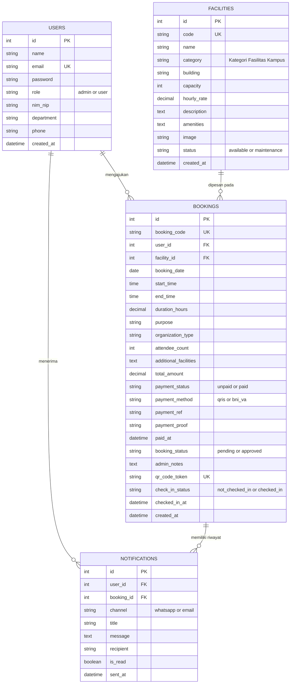
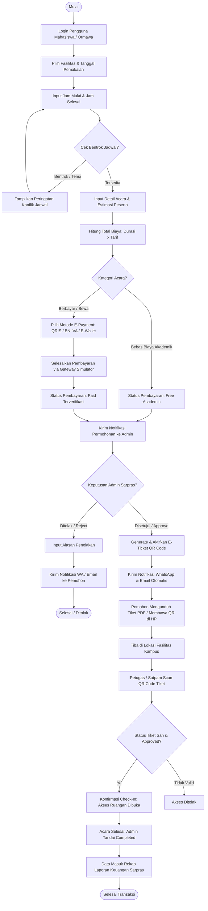

# LAPORAN TUGAS PROYEK UTS TAKE-HOME
## MATA KULIAH: E-APPLICATION (SEMESTER GANJIL 2025/2026)
**Program Studi:** D3 Teknik Informatika  
**Fakultas:** Vokasi, Universitas Sumatera Utara (USU)  
**Waktu Pelaksanaan:** Oktober 2026  

---

### IDENTITAS MAHASISWA & PROYEK
* **Judul Tugas:** Judul 2 — E-Booking & E-Payment Fasilitas Kampus (Lab, Aula, Lapangan)
* **Nama Sistem:** **USU SmartFacility** *(Sistem Informasi E-Booking, E-Payment, & Retribusi Fasilitas Terintegrasi)*
* **Teknologi Stack:** PHP 8.2 (Modular Architecture), MySQL / SQLite (Dual Driver PDO), FullCalendar.js v6, Chart.js v4, QRCode.js, Bootstrap 5 & Vanilla CSS.
* **Tautan Repository / Arsip:** `USU-SmartFacility-SourceCode.zip`

---

## BAB I: PENDAHULUAN

### 1.1 Latar Belakang
Pengelolaan sarana dan prasarana (sarpras) di lingkungan kampus, khususnya di Fakultas Vokasi dan Program Studi D3 Teknik Informatika Universitas Sumatera Utara, menghadapi berbagai tantangan operasional:
1. **Sering Terjadi Bentrok Jadwal:** Peminjaman ruangan seperti Laboratorium Komputer D3 TI, Aula Serbaguna, Gelanggang Olahraga, dan Ruang Seminar sering kali diajukan secara manual melalui lembar disposisi fisik, sehingga staf kesulitan memantau slot jam yang telah terisi secara real-time.
2. **Kurangnya Transparansi Biaya Retribusi & Pembayaran:** Untuk kegiatan tertentu atau pihak mitra eksternal yang memerlukan kontribusi pemeliharaan/retribusi, proses pembayaran tunai rentan terhadap ketidakakuratan pembukuan dan memakan waktu verifikasi.
3. **Pemeriksaan Akses Masuk Masih Konvensional:** Petugas di lapangan (satpam atau teknisi laboratorium) kesulitan memverifikasi apakah pihak yang sedang menggunakan ruangan benar-benar telah mengantongi izin resmi dari pimpinan fakultas.

Untuk menjawab permasalahan tersebut, dikembangkan **USU SmartFacility**, sebuah platform *E-Application* berbasis web yang menggabungkan:
- **Pengecekan Anti-Bentrok Otomatis** pada saat pengajuan slot jam.
- **Kalender Interaktif Real-Time** menggunakan FullCalendar.js.
- **Transaksi Elektronik (E-Payment Gateway Simulator)** mendukung QRIS Nasional, BNI Virtual Account USU, dan Dompet Digital.
- **E-Ticket Digital dengan QR Code Terenkripsi** yang dapat diverifikasi langsung oleh petugas melalui pemindai web (*Scanner Check-In*).
- **Dashboard Analitik & Rekapitulasi Laporan Keuangan** berstandar dokumen resmi universitas.

### 1.2 Tujuan Proyek
1. Menerapkan konsep mata kuliah E-Application secara menyeluruh (Autentikasi Multi-Role, Operasi CRUD, Validasi Transaksi Elektronik, dan Integrasi Gateway Pembayaran).
2. Membangun sistem yang mencegah duplikasi reservasi fasilitas (*schedule collision prevention*).
3. Memberikan kemudahan bagi mahasiswa, dosen, dan ormawa (seperti HIMATIF USU) dalam mengajukan permohonan fasilitas kampus 24/7.
4. Menyediakan transparansi laporan keuangan retribusi sarpras bagi pimpinan Fakultas Vokasi USU.

---

## BAB II: PERANCANGAN SISTEM (SYSTEM DESIGN)

### 2.1 Use Case Diagram
Sistem memiliki 2 (dua) aktor utama:
1. **User (Mahasiswa / Dosen / Pengurus Ormawa HIMATIF):** Mengakses katalog fasilitas, memantau kalender real-time, mengajukan reservasi waktu, melakukan transaksi simulasi e-payment, mengunduh tiket ber-QR Code, serta membatalkan permohonan.
2. **Administrator (Kepala Sarpras / BMN Vokasi USU):** Mengelola master data fasilitas (CRUD), memverifikasi berkas dan pembayaran, melakukan *Approve / Reject* dengan catatan resmi, memantau status *check-in*, melihat grafik analitik, serta mencetak laporan pemakaian berformat PDF/Excel.

```mermaid
flowchart LR
    subgraph Aktor ["Aktor Pengguna"]
        User["Mahasiswa / Ormawa"]
        Admin["Admin Sarpras USU"]
    end

    subgraph System ["Sistem E-Booking & E-Payment (USU SmartFacility)"]
        UC1(["Registrasi & Login Akun"])
        UC2(["Jelajahi Fasilitas & Detail Spesifikasi"])
        UC3(["Pantau Kalender Ketersediaan Real-Time"])
        UC4(["Pengajuan E-Booking Fasilitas"])
        UC5(["Validasi Otomatis Anti-Bentrok Jadwal"])
        UC6(["Transaksi E-Payment: QRIS / BNI VA"])
        UC7(["Akses E-Ticket & Unduh QR Code"])
        UC8(["Verifikasi Tiket & Check-in Mandiri"])
        UC9(["Approval / Penolakan Reservasi"])
        UC10(["Kelola Data Fasilitas CRUD"])
        UC11(["Dashboard KPI & Grafik Analitik"])
        UC12(["Rekapitulasi Laporan PDF & Excel"])
    end

    User --> UC1
    User --> UC2
    User --> UC3
    User --> UC4
    User --> UC6
    User --> UC7

    Admin --> UC1
    Admin --> UC8
    Admin --> UC9
    Admin --> UC10
    Admin --> UC11
    Admin --> UC12

    UC4 -.->|include| UC5
    UC4 -.->|include| UC6
    UC9 -.->|triggers| UC7
```



---

### 2.2 Entity Relationship Diagram (ERD)
Basis data dirancang dengan normalisasi relasional untuk menjamin integritas data transaksi permohonan fasilitas.



---

### 2.3 Flowchart Transaksi Elektronik (E-Booking & E-Payment)
Flowchart ini mengilustrasikan siklus hidup reservasi dari pengecekan bentrok hingga validasi kedatangan di lokasi (*check-in*):



---

## BAB III: IMPLEMENTASI FITUR UNGGULAN

| No | Fitur E-Application | Implementasi Teknis & Keunggulan |
|---|---|---|
| 1 | **Multi-Role Authentication** | Role `admin` (Sarpras USU) dan `user` (Mahasiswa/Ormawa/Dosen). Dilengkapi fitur **1-Click Quick Demo Login** untuk kemudahan demonstrasi saat penilaian UTS. |
| 2 | **Kalender Ketersediaan Real-Time** | Terintegrasi dengan **FullCalendar.js v6**, menampilkan pemakaian harian/mingguan/bulanan dengan pembedaan warna kategori fasilitas (*Laboratorium: Hijau, Aula: Kuning Emas, Lapangan: Biru, Ruang Seminar: Ungu*). |
| 3 | **Validasi Anti-Bentrok Slot Jam** | Memiliki algoritma deteksi irisan waktu `$startTime < end_time AND $endTime > start_time` secara asinkron (AJAX fetch ke `/api/check_slot.php`) sehingga form langsung memberi feedback visual hijau/merah. |
| 4 | **Simulasi Multi-Channel E-Payment** | Mendukung pembayaran instan QRIS Nasional dengan QR Code dinamis dan NMID simulator, BNI Virtual Account USU (Bank Resmi Kampus), E-Wallet GoPay/OVO, dan transfer manual dengan upload bukti bayar. |
| 5 | **E-Ticket Ber-QR Code Terenkripsi** | Tiket digital dengan styling perforasi resmi, stempel verifikasi BMN USU, dan QR Code mandiri (Dual-engine: Online API + Fallback Offline Canvas via `qrcode.min.js`). |
| 6 | **Portal Verifikasi Publik & Scanner Check-In** | Halaman `/verify.php` yang dapat diakses melalui pemindaian kamera HP oleh petugas satpam/teknisi lab untuk memverifikasi keabsahan tiket dan tombol 1-klik *Check-In Kehadiran*. |
| 7 | **Approval Workflow & Notifikasi Realistis** | Admin dapat menyetujui, menolak dengan catatan alasan, atau menyelesaikan acara. Sistem mencatat log notifikasi WhatsApp & Email terformat. |
| 8 | **Laporan Eksekutif PDF & Excel (CSV)** | Laporan pemakaian fasilitas berfilter tanggal, rekapitulasi jam terbang dan pendapatan retribusi kas, tombol ekspor langsung ke file `.csv` Excel, dan cetak PDF dengan Kop Surat Resmi Universitas Sumatera Utara. |

---

## BAB IV: DOKUMENTASI ANTARMUKA (16 HALAMAN LENGKAP)

Berikut adalah daftar dokumentasi halaman antarmuka sistem yang telah diuji dan diverifikasi secara langsung di browser:

1. **Halaman Beranda (`/index.php`)**: Menampilkan *hero banner* bertema warna hijau dan kuning khas USU, ringkasan statistik (Fasilitas, Event Sukses, Mahasiswa Terlayani), alur 4 langkah peminjaman, dan katalog fasilitas unggulan.
2. **Halaman Katalog Fasilitas (`/facilities.php`)**: Menyajikan daftar seluruh fasilitas kampus lengkap dengan pencarian kata kunci dan filter kategori interaktif (*Laboratorium, Aula, Lapangan Olahraga, Ruang Seminar*).
3. **Halaman Rincian Fasilitas (`/facility_detail.php?id=1`)**: Menampilkan foto definisi tinggi, deskripsi spesifikasi komputer/perangkat, daftar sarana penunjang (*amenities*), serta tabel jadwal pemakaian terdekat.
4. **Halaman Kalender Ketersediaan Real-Time (`/calendar.php`)**: Kalender terintegrasi FullCalendar.js dengan filter per fasilitas dan modal rincian kegiatan saat agenda diklik.
5. **Halaman Masuk Multi-Role (`/login.php`)**: Antarmuka login aman dilengkapi fitur inovatif **1-Click Quick Demo Login** untuk peran Admin, Mahasiswa, dan Ketua HIMATIF.
6. **Halaman Pendaftaran Akun (`/register.php`)**: Formulir registrasi akun mahasiswa/dosen baru dengan validasi email dan nomor WhatsApp untuk penerimaan notifikasi.
7. **Halaman Formulir Pengajuan E-Booking (`/booking.php`)**: Dilengkapi validasi otomatis deteksi bentrok jadwal secara langsung (*live conflict indicator*) dan kalkulator durasi sewa real-time.
8. **Halaman Checkout E-Payment (`/checkout.php`)**: Halaman pembayaran elektronik dengan pilihan QRIS, Virtual Account BNI USU, E-Wallet, serta penghitung waktu mundur (*countdown timer* 15 menit).
9. **Halaman Konfirmasi Transaksi Sukses (`/payment_success.php`)**: Menampilkan nomor referensi pembayaran, rincian biaya, notifikasi pengiriman pesan WhatsApp, dan tautan langsung ke E-Ticket.
10. **Halaman E-Ticket Resmi Ber-QR Code (`/ticket.php`)**: Tiket digital resmi bersudut perforasi, barcode/QR code beresolusi tajam, stempel digital *Approved BMN USU*, dan tata letak siap cetak (*print-ready*).
11. **Halaman Verifikasi Publik & Scanner Check-In (`/verify.php`)**: Antarmuka pembaca kode QR tiket yang memvalidasi keaslian reservasi dan mencatat jam kehadiran peminjam di lokasi.
12. **Halaman Riwayat Booking Mahasiswa (`/my_bookings.php`)**: Dashboard personal mahasiswa untuk melacak status pemesanan (*Pending, Approved, Completed*), tombol pelunasan, dan opsi pembatalan.
13. **Halaman Dashboard Administrator (`/admin/index.php`)**: Panel kendali sarpras berisi 4 kartu KPI (Perlu Tindakan, Jadwal Aktif, Total Retribusi, Total Fasilitas), grafik batang frekuensi peminjaman, dan grafik lingkaran komposisi status.
14. **Halaman Manajemen & Approval Booking Admin (`/admin/bookings.php`)**: Tabel komprehensif seluruh transaksi dengan aksi *Approve*, *Reject* dengan modal alasan, dan pratinjau bukti transfer.
15. **Halaman CRUD Fasilitas Kampus (`/admin/facilities.php` & `/admin/facility_form.php`)**: Formulir pengelolaan data sarana kampus, pengunggahan foto fasilitas, penentuan kapasitas, dan pengaturan tarif sewa per jam.
16. **Halaman Laporan Pemakaian & Rekapitulasi Kas (`/admin/reports.php`)**: Laporan dinamis dengan filter tanggal, total jam pemakaian, total penerimaan uang kas, fitur download file CSV untuk Excel, serta format cetak ber-Kop Surat Resmi USU Vokasi.

---

## BAB V: PANDUAN MENJALANKAN APLIKASI

### Opsi A: Menggunakan PHP Built-in Server (Sangat Cepat & Mandiri)
1. Ekstrak file arsip `USU-SmartFacility-SourceCode.zip`.
2. Buka terminal (PowerShell atau Command Prompt) pada direktori hasil ekstrak.
3. Jalankan perintah server:
   ```bash
   php -S 127.0.0.1:8000
   ```
4. Buka peramban (browser) di alamat: `http://localhost:8000`.
   *(Sistem otomatis mendeteksi basis data SQLite bawaan yang telah terisi data lengkap tanpa perlu setup MySQL terlebih dahulu).*

### Opsi B: Menggunakan XAMPP / Laragon (Standar Kampus)
1. Salin folder proyek ke direktori `C:\xampp\htdocs\usu-smartfacility`.
2. Buka aplikasi **XAMPP Control Panel**, lalu aktifkan modul **Apache** dan **MySQL**.
3. Buka **phpMyAdmin** di browser (`http://localhost/phpmyadmin`).
4. Buat basis data baru dengan nama: `usu_smartfacility`.
5. Klik tab **Import**, lalu pilih file `database/schema.sql` yang telah disediakan, kemudian klik **Go**.
6. Buka file `config/database.php`, lalu ubah pengaturan driver menjadi:
   ```php
   define('DB_DRIVER', 'mysql');
   ```
7. Buka aplikasi di browser: `http://localhost/usu-smartfacility`.

---

## BAB VI: AKUN PENGUJIAN DEMO (CREDENTIALS)

| Role / Peran | Nama Akun | Email Login | Kata Sandi | Kegunaan Pengujian |
|---|---|---|---|---|
| **Admin Sarpras** | Dr. Ir. Budi Rahardjo, M.Kom | `admin@usu.ac.id` | `admin123` | Akses Dashboard Admin, Approval Booking, CRUD Fasilitas, Cetak Laporan Keuangan |
| **Mahasiswa** | Muhammad Rizky Pratama | `mahasiswa@usu.ac.id` | `user123` | Simulasi Booking Aula/Lab, Checkout E-Payment QRIS, Akses E-Ticket QR |
| **Ormawa Kampus** | HIMATIF USU (Ketua Kevin) | `himatif@usu.ac.id` | `user123` | Simulasi Kegiatan Himpunan Mahasiswa TI, Booking Lapangan & Lab |
| **Dosen** | Dra. Sri Wahyuni, M.Sc | `dosen@usu.ac.id` | `user123` | Simulasi Pengajuan Bebas Biaya (Kegiatan Akademik Resmi) |

